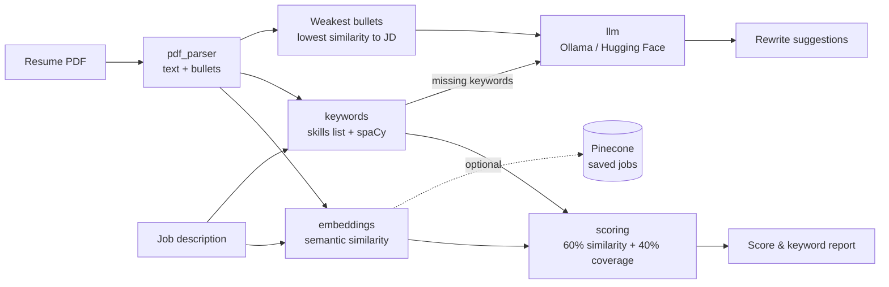

# 📄 Resume–JD Matcher

**Upload your resume, paste a job description, and get a match score, the keywords you're missing, and AI-written rewrites for your weakest bullet points.**

## Features

- **Match score (0–100):** semantic similarity combined with keyword coverage, with a breakdown of how the score was calculated.
- **Missing keywords:** skills and phrases from the JD that your resume doesn't mention, found with a curated skills list plus spaCy NLP.
- **Bullet rewrite suggestions:** an LLM rewrites your 5 weakest bullets with strong action verbs and relevant keywords. It **never invents numbers**; it inserts placeholders like `[X%]` for you to fill in.
- **ATS readability check:** warns you if your PDF has no text layer (for example, a scanned image), which most ATS can't read either.
- **Saved jobs (optional):** store job descriptions in Pinecone and find which ones best fit your resume.
- **Runs fully locally** with Ollama, or deploys anywhere with the Hugging Face Inference API.

## Architecture



| Module | Responsibility |
|---|---|
| `matcher/pdf_parser.py` | Extracts text with pdfplumber, normalizes it, and splits out bullet points |
| `matcher/embeddings.py` | Loads `all-MiniLM-L6-v2`, embeds long text by chunking and averaging, and computes cosine similarity |
| `matcher/keywords.py` | Finds JD keywords (skills list plus noun phrases) and checks which ones the resume contains |
| `matcher/scoring.py` | Combines similarity and keyword coverage into the final score |
| `matcher/llm.py` | Provider abstraction (`generate(prompt) -> str`), the rewrite prompt, and output parsing |
| `matcher/job_store.py` | Saves JDs to Pinecone and runs the "best matching jobs" search |
| `app.py` | Streamlit UI only. No business logic lives here. |

## How the score is calculated

```
final score = round(100 × (0.6 × semantic similarity + 0.4 × keyword coverage))
```

- **Semantic similarity (60%):** the resume and JD are each split into ~150-word chunks, embedded with `all-MiniLM-L6-v2`, and averaged into one vector per document. The score is the cosine similarity between the two vectors, clipped to 0–1. This captures meaning: "built backend services" relates to "REST API development" even though no words are shared.
- **Keyword coverage (40%):** matched JD keywords ÷ total JD keywords. This is closer to what ATS filters check, and it catches hard requirements that embeddings blur over.

Using both signals keeps either one from being gamed. Keyword stuffing alone won't get a high score, and a resume that's broadly relevant but missing the core tools gets penalized. The weights are constants at the top of `matcher/scoring.py`.

**Colors:** 🔴 under 50 · 🟠 50–74 · 🟢 75+

### Keyword extraction details

1. **Curated skills list** (`data/skills.txt`, ~200 skills): case-insensitive, whole-word matching with aliases (`scikit-learn` / `sklearn`, `Node.js` / `NodeJS`, `Kubernetes` / `K8s`). Spaces and hyphens are interchangeable. Very short names like `Go` and `R` are matched case-sensitively so that "go above and beyond" doesn't count as a skill.
2. **spaCy noun chunks:** these catch domain phrases the list doesn't have, such as "experiment tracking" or "event-driven architecture". Generic words ("experience", "team"), named entities (the company name, dates), and single words are filtered out. Phrases are compared by lemma, so "data pipelines" matches "data pipeline".

## Tech stack

| Purpose | Tool |
|---|---|
| Language | Python 3.10+ |
| UI | Streamlit |
| PDF extraction | pdfplumber |
| Embeddings | sentence-transformers (`all-MiniLM-L6-v2`) |
| Keywords | spaCy (`en_core_web_sm`) plus a curated skills list |
| LLM | Ollama (local) or Hugging Face Inference API |
| Vector DB (optional) | Pinecone |
| Config | python-dotenv |
| Tests | pytest |

## Setup

### 1. Install

```bash
git clone <your-repo-url>
cd resume-jd-matcher
python -m venv .venv
source .venv/bin/activate        # Windows: .venv\Scripts\activate
pip install -r requirements.txt
cp .env.example .env             # Windows: copy .env.example .env
```

`requirements.txt` installs the CPU build of PyTorch and the spaCy English model, so no extra download steps are needed. The embedding model (~90 MB) downloads automatically on first run.

### 2a. LLM option A: Ollama (local, free, private)

1. Install [Ollama](https://ollama.com/download).
2. Pull a model: `ollama pull llama3`
3. Keep `LLM_PROVIDER=ollama` in `.env`.

### 2b. LLM option B: Hugging Face Inference API (no local model)

1. Create a token at <https://huggingface.co/settings/tokens> with "Make calls to Inference Providers" permission.
2. In `.env`, set:
   ```
   LLM_PROVIDER=huggingface
   HF_API_TOKEN=hf_...
   ```
3. Optionally change `HF_MODEL` to any chat model served by Hugging Face's inference providers.

> If neither LLM is available, the app still works. Only the suggestions section shows a message.

### 3. (Optional) Saved jobs with Pinecone

Create a free account at [pinecone.io](https://www.pinecone.io/) and set `PINECONE_API_KEY` in `.env`. The index (`PINECONE_INDEX`, default `jd-matcher`) is created automatically on first use. Without a key, the Saved Jobs tab is hidden.

### 4. Run

```bash
streamlit run app.py
```

Open <http://localhost:8501>. To try it right away, use `sample_data/sample_resume.pdf` and paste in `sample_data/sample_jd.txt`.

## Running tests

```bash
pytest
```

Tests cover keyword extraction (including spelling variants and false positives), the scoring formula, PDF parsing (including the "no readable text" error), the LLM prompt and output parsing, and the Pinecone store. Ollama, Pinecone, and the embedding model are mocked, so no services or API keys are needed.

## Deployment

### Docker

```bash
docker build -t resume-jd-matcher .
docker run -p 8501:8501 --env-file .env -e LLM_PROVIDER=huggingface resume-jd-matcher
```

The image defaults to `LLM_PROVIDER=huggingface` because containers usually don't have Ollama. The embedding model is downloaded at build time, so the first request is fast.

### Streamlit Community Cloud

1. Push the repo to GitHub and create a new app pointing at `app.py`.
2. In **Settings → Secrets**, add:
   ```toml
   LLM_PROVIDER = "huggingface"
   HF_API_TOKEN = "hf_..."
   # PINECONE_API_KEY = "..."   (optional)
   ```
   Streamlit exposes top-level secrets as environment variables, so no code changes are needed.

### Railway

Deploy from the GitHub repo (Railway detects the `Dockerfile`) and add the same variables under **Variables**. Railway maps traffic to the exposed port 8501.

## Screenshots


## Future improvements

- **Score calibration:** raw cosine similarity between related documents rarely goes above ~0.8. Calibrating against a labelled set of resume/JD pairs would make the scale more intuitive.
- **Requirement weighting:** weight "required" keywords above "nice to have" ones by detecting JD sections.
- **Section-aware parsing:** detect Experience / Skills / Education sections for more targeted feedback.
- **OCR fallback** (for example, Tesseract) for scanned PDFs, while still warning the user about ATS compatibility.
- **DOCX support** for resumes.
- **Streaming LLM output** so suggestions appear as they're generated.
- **Cross-encoder re-ranking** for more accurate saved-job matching.
- **Learned skills list:** expand `skills.txt` automatically from a skills taxonomy such as ESCO or O*NET.
